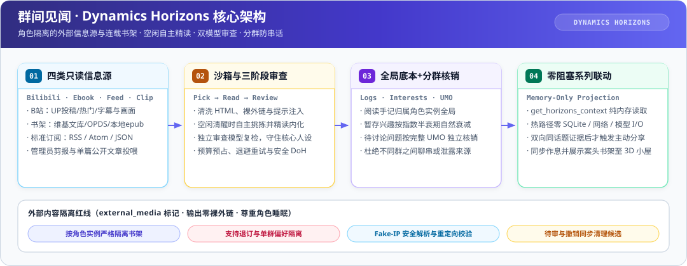

# 群间见闻 · Dynamics Horizons

**群间系列角色外部信息源与连载书架：空闲清醒时自主精读，经独立审查沉淀阅读手记、暂存兴趣与分群待讨论话题。**

[核心能力](#核心能力) · [系列联动](#与群间系列的联动) · [快速开始](#快速开始) · [群间系列生态](#群间系列生态) · [文档与许可](#进阶文档与许可)

---

## 核心能力

- **按角色隔离的四类只读信息源**（`identity = [persona_id, instance_id]`）：
  - **B 站只读源（`bilibili`）**：关注 UP 投稿/图文、热门榜单与可选只读推荐流，支持官方 AI 总结、字幕、简介及视频画面多模态提取，零写操作。
  - **电子书连载源（`ebook`）**：中文维基文库、Gutendex 公版书、OPDS 目录及本地 `.epub` / `.txt` 逐章切片追读，持久化真实阅读进度与书架状态。
  - **标准订阅源（`feed`）**：RSS 2.0、Atom 1.0、JSON Feed 1.1（支持 ETag / If-Modified-Since 与 304 积压保护）。
  - **管理员投喂（`manual`）**：粘贴剪报文本或提取单篇公开文章正文。
- **沙箱防注入与三阶段审查**：外部内容严格标记为 `external_media`，清洗 HTML、裸外链、广告联系词与提示词注入；遵循 **挑拣 → 精读内化 → 独立审查模型复检** 三步流转，守住角色固定设定红线（默认要求独立审查 Provider，亦可选 `allow_same_provider_for_review=true` 以空历史独立调用）。
- **全局阅读底本 + 分群独立核销**：阅读手记与指数衰减的暂存兴趣归属角色实例全局；待讨论话题按完整 UMO 独立核销，严防跨群串话。
- **稳健运行与网络安全**：每日精读与模型调用额度持久预占、临时错误分级退避重试；内置 Fake-IP（Clash/Mihomo `198.18.0.0/15`）安全 DoH 解析与重定向校验。

## 与群间系列的联动

- **群间 · Chat Dynamics**：通过纯内存同步接口 `get_horizons_context` 提供见闻上下文（回复热路径零 SQLite / 网络 / 模型 I/O，输出绝不含裸外链）；开启 `proactive_enabled` 后，仅在同角色、同会话、同成员已有至少两轮双向同话题交流时生成受控主动分享候选，遵循退订、冷却与共享额度。
- **群间世界 · Dynamics World**：双向感知角色清醒/睡眠/暂停状态（睡眠期间延期审核与精读），并将案头阅读进度与书签同步至 3D 小屋书架与书桌。

## 快速开始

1. 在 AstrBot（`>=4.29.4,<5`）安装本插件，并配合 **群间 · Chat Dynamics**（可选搭配 **群间世界**）。
2. 在插件配置中指定分析模型与独立审查模型（均需普通聊天模型），按需设置每日精读预算与 `proactive_enabled` / `proactive_sessions`。
3. 打开 **「群间见闻」** Web 面板：添加角色专属的信息源或上传本地电子书，在面板查看作息阻塞、真实书架进度、待审提案、来源证据与审核撤销。

---

## 群间系列生态

| 插件 | 仓库与标识 | 核心定位 |
| --- | --- | --- |
| **群间 · Chat Dynamics** | [`astrbot_plugin_chat_dynamics`](https://github.com/ysyhlly/astrbot_plugin_chat_dynamics) | 核心对话调度层：碎发聚合、话题路由、参与决策与节奏交付 |
| **群间世界 · Dynamics World** | [`astrbot_plugin_dynamics_world`](https://github.com/ysyhlly/astrbot_plugin_dynamics_world) | 角色卡、世界书、双地图天气、持续生活与 3D 实况小屋 |
| **群间记忆 · Dynamics Memory** | [`astrbot_plugin_dynamics_memory`](https://github.com/ysyhlly/astrbot_plugin_dynamics_memory) | 长期记忆、混合召回、2D/3D 图谱与原文证据冲突审查 |
| **群间学习 · Dynamics Learning** | [`astrbot_plugin_dynamics_learning`](https://github.com/ysyhlly/astrbot_plugin_dynamics_learning) | 固定性格红线下的成员资料、黑话好感与可回滚审查学习 |
| **群间见闻 · Dynamics Horizons**（当前） | [`astrbot_plugin_dynamics_horizons`](https://github.com/ysyhlly/astrbot_plugin_dynamics_horizons) | 角色隔离外部信息源与书架、自主精读与分群待讨论话题 |
| **群间游戏 · Dynamics Games** | [`astrbot_plugin_dynamics_games`](https://github.com/ysyhlly/astrbot_plugin_dynamics_games) | 共读/约局/接龙/挑战/共创协作与四大群聊娱乐引擎 |
| **群间史记 · Dynamics Chronicle** | [`astrbot_plugin_group_chronicle`](https://github.com/ysyhlly/astrbot_plugin_group_chronicle) | 原文依据的长期群史卷册、人物传记与群文化梗沿革 |
| **群间视觉 · Visual Media** | [`astrbot_plugin_visual_media`](https://github.com/ysyhlly/astrbot_plugin_visual_media) | 表情收集检索、多模态生图改图与角色视觉形象管理 |

---

## 进阶文档与许可

- [发布说明与验证边界](RELEASE_NOTES.md) · [更新日志](CHANGELOG.md)
- 交流与反馈：项目反馈群兼聊天群 QQ `203363132`
- 本项目基于 [MIT License](LICENSE) 开源。
